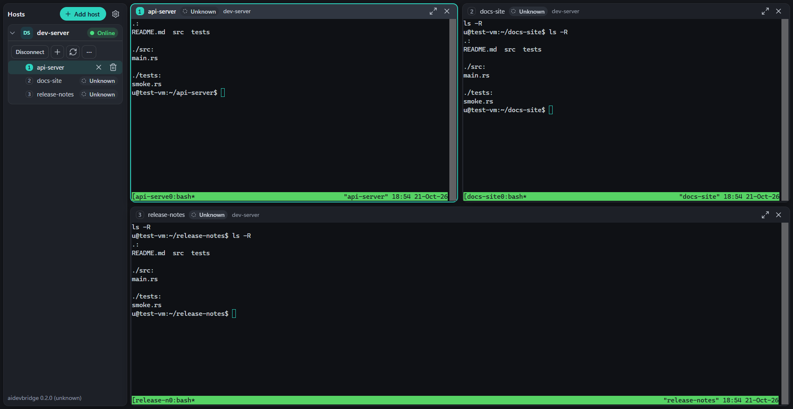

# aidevbridge



aidevbridge is a Windows desktop app for coding agents that run in tmux
sessions on your own Linux machines. It connects over SSH, shows the
sessions of several hosts in one window and tells you which agent is waiting
for you. Nothing is installed on the hosts.

The project is in early development. Releases appear on the
[Releases page](https://github.com/ITBrain258/aidevbridge/releases); the
Windows packages are not code-signed. [docs/stand.md](docs/stand.md) tracks
the status and the open items, [CHANGELOG.md](CHANGELOG.md) the changes (both
in German).

## What it is

- **One window for many hosts.** The sidebar lists your hosts and their tmux
  sessions; a click opens a session as a live terminal. Up to nine terminals,
  at most eight per host, arrange themselves by count. Drag a terminal's head
  onto another to swap them, drag the gap between two to resize them, and
  maximize one with Ctrl+Shift+M.
- **Agent status.** Each session shows whether its agent is Waiting, Busy,
  Idle or Ended. Waiting sessions collect at the top of the sidebar, oldest
  first, with their wait time. The window title counts them, the taskbar
  flashes once when one starts waiting while the window is not focused, and
  Ctrl+Shift+A jumps to the next one.
- **A terminal that behaves like Windows Terminal.** Ctrl+C copies a
  selection and otherwise still interrupts the program, Ctrl+V pastes,
  Ctrl+Shift+F finds text, and Ctrl+click opens a link in your browser.
  Opening a session loads up to 5,000 lines of its tmux history.
- **Keeps going through network trouble.** Hosts with a key file or ssh-agent
  repair their connection and reattach their terminals by themselves after
  standby, a network change or a VPN switch. After a restart the app
  reconnects these hosts and reopens your terminals.
- **Nothing on the host.** No daemon, no hook, no configuration change: only
  SSH, tmux and the agent you start yourself. Passwords and key passphrases
  are never stored.

Quick open (Ctrl+Shift+P) finds sessions, hosts and actions, and
Settings → Shortcuts lists every shortcut. aidevbridge is built with
[Tauri 2](https://tauri.app/): a Rust backend and a TypeScript frontend with
xterm.js.

## Before you download

- **The packages are not code-signed yet.** Windows SmartScreen therefore
  warns with "Windows protected your PC". Check the file first (see below),
  then choose **More info** → **Run anyway**.
- **Smart App Control blocks it.** If Smart App Control is set to On
  (Windows Security → App & browser control → Smart App Control), Windows
  does not start unsigned apps such as this one, also when you build it
  yourself. There is no exception for a single app.
- **Check the file.** Every release lists the SHA-256 of each package, taken
  from the `release-manifest.json` of its build. In PowerShell,
  `Get-FileHash .\aidevbridge-0.2.0-windows-x64.zip -Algorithm SHA256`
  must print the same value. It prints upper-case letters where the release
  lists lower-case ones; letter case does not matter.
- **Or build it yourself**, see [Build from source](#build-from-source).

## Host requirements

aidevbridge installs nothing on a host and changes no configuration there.
Each host needs:

- SSH access with a key file, ssh-agent or password, and a POSIX login shell
  such as bash, zsh or dash. fish and csh are not supported.
- `tmux` 3.0 or newer on the non-interactive SSH `PATH`. Numeric session
  identity and agent status work with the measured versions 3.0, 3.3a, 3.4
  and 3.6; other versions list sessions by name and show "Unknown". Debian 12
  ships 3.3a and Ubuntu 24.04 ships 3.4; Ubuntu 22.04 ships 3.2a, which runs
  without status. For 3.6 only the exact answer `tmux 3.6` counts, measured
  on Ubuntu 26.04.1 with the package `tmux 3.6a-2ubuntu0.1`; an unmodified
  3.6a build answers `tmux 3.6a` and, like 3.5 and 3.5a, shows "Unknown".
- `base64` and a writable tmux socket directory (`$TMUX_TMPDIR` or `/tmp`).
  Both are present on common distributions.

Install tmux with the host's package manager, for example:

```sh
sudo apt install tmux      # Debian, Ubuntu
sudo dnf install tmux      # Fedora, RHEL, Rocky, Alma
sudo pacman -S tmux        # Arch
sudo zypper install tmux   # openSUSE
sudo apk add tmux          # Alpine
```

When a host is added, aidevbridge checks these requirements and names the
missing one. Agent status also needs the agent started by hand in a session;
see [Supported agents and detected states](#supported-agents-and-detected-states).

## Install

aidevbridge runs on Windows 10 and 11 (x64). Release 0.2.0 comes as a ZIP,
`aidevbridge-0.2.0-windows-x64.zip`: extract the whole ZIP into a folder and
start `aidevbridge.exe`. Installers (MSI and setup EXE) follow once their
license page and the WebView2 terms presentation are accepted.

The window is drawn by Microsoft Edge WebView2, which current Windows 10 and
11 already include; the ZIP expects WebView2 to be installed and does not
download it. The ZIP carries the license texts in a `licenses` folder
(`licenses/index.html`); keep it next to the program.

There is no automatic update. To hear about new versions, watch the
repository's releases on GitHub (Watch → Custom → Releases).

**Upgrading from agentbridge.** Before 0.2.0 the app was called agentbridge.
When its own folder `%APPDATA%\io.github.itbrain258.aidevbridge\` holds no
`settings.toml` yet, aidevbridge copies `settings.toml` from
`%APPDATA%\agentbridge\` on start and leaves the old folder as it is; the
window position starts fresh. Your sessions on the hosts stay visible,
because the tmux socket is still named `agentbridge`.

**Removing** the app: close it and delete its folder. Your settings and the
host keys you accepted stay; see [Privacy](#privacy) for where they are.

## Quick start

1. Start aidevbridge. The welcome page suggests the hosts from your
   `~/.ssh/config` (`%USERPROFILE%\.ssh\config`). Pick one, or choose
   **Add a host manually** and enter the host, port, user and the
   authentication: a key file, ssh-agent or a password.
2. On the first connection the app shows the fingerprint of the host key.
   Compare it with the host, for example with
   `ssh-keygen -lf /etc/ssh/ssh_host_ed25519_key.pub`, and choose
   **Trust and continue**. The app then checks tmux, `base64` and the tmux
   socket directory on the host.
3. Choose **New session** under the host, pick a working directory on the
   host and, if you like, a name. The session opens as a terminal.
4. Start your agent in that terminal, for example `claude`, `codex` or
   `grok`. Its status appears as a pill next to the session and in the
   terminal's head.
5. Click more sessions in the sidebar to open them next to each other.
   Ctrl+, opens the settings.

The sidebar lists the sessions on the app's own tmux socket, `agentbridge`.
To start one from an SSH shell instead, run `tmux -L agentbridge new -s work`
on the host. Sessions on tmux's default socket do not appear.

## Supported agents and detected states

| State | Meaning |
| --- | --- |
| Waiting | The agent waits for you: a permission prompt, a question or a dialog. |
| Busy | The agent is working. |
| Idle | The agent is ready for the next prompt. |
| Ended | The session's active pane has exited, or the session is gone from the host. |
| Unknown | No status source: no supported agent runs in the pane, the agent shows no status, its output has a form that was not measured, or the host's tmux version is not one of the measured ones. |
| As of HH:MM | The status could not be read (failed query, interrupted connection, reconnect). The pill keeps the time of the last value, its tooltip names that value, and the host does not count as waiting until a query succeeds again. |

| Agent | Where the status comes from | Measured with |
| --- | --- | --- |
| Claude Code | `claude agents --json` on the host, read-only | 2.1.269 and 2.1.270 |
| Codex | the terminal title that tmux keeps for the pane | 0.154.0 |
| Grok | the terminal title that tmux keeps for the pane | 1.0.30; the approval title with 1.0.13 |
| agy, OpenCode | no status in their title: Unknown | |
| Gemini CLI and others | not measured: Unknown | |

- The agent must run directly in the session's shell, started by hand. With
  several windows or panes, the active pane of the active window counts.
- Claude Code: `claude` must be in `~/.local/bin` or on the non-interactive
  SSH `PATH`. A row counts only if its process is the pane's process or a
  direct child of it. Waiting covers a permission prompt, input needed, a
  sandbox or worker request and an open dialog.
- Codex: a freshly started Codex shows "Unknown" until its first thread has
  a name. Title settings other than the defaults (`tui.animations`,
  `tui.terminal_title`) can hide its spinner, so a working Codex may then
  show "Idle".
- Grok: when Grok moves a long shell command to the background, its title
  shows "Idle" for a while although the command still runs.
- Newer agent versions may change these forms; a form the app does not know
  shows "Unknown", never a guess.
- While a host is connected, the app polls about every 2 seconds. Each poll
  runs two short tmux commands, one read-only title read for the active
  panes (`tmux display-message` and program names from `/proc`, no command
  lines), one short `claude` process and, while agents run, one read-only
  `/proc` lookup, whatever the number of sessions.

## Privacy

- **Only SSH.** The app connects to your hosts over SSH and to nothing else:
  no telemetry, no update check, no account. Its window is drawn by
  Microsoft Edge WebView2, a Windows component with its own updates and data
  practices; the app loads no remote content into it.
- **Links.** A plain click on a link in a terminal does nothing. Ctrl+click
  opens http and https links in your default browser. A link whose text
  doesn't show its address (OSC 8) names the address in its tooltip, and
  Ctrl+click first shows the full address with **Open link**.
- **On your hosts** the app runs tmux on its own socket `agentbridge` and
  sets a few tmux options there (`history-limit`, `remain-on-exit`,
  `terminal-overrides`). For the status it runs the read-only
  `claude agents --json` and reads pane titles and program names from
  `/proc`. It installs nothing and changes no configuration.
- **On your PC** aidevbridge keeps:
  - `%APPDATA%\io.github.itbrain258.aidevbridge\settings.toml`: your hosts
    (name, address, port, user, key file path, authentication method),
    preferences and the workspace (open terminals, recent folders).
    Settings → About shows the exact path. The window position is stored in
    the same folder.
  - `%USERPROFILE%\.ssh\known_hosts`: the host keys you accepted. The file is
    shared with OpenSSH; the app only appends to it.
  - `%LOCALAPPDATA%\io.github.itbrain258.aidevbridge\`: WebView2 data.
- **Passwords and key passphrases are never stored.** The app asks again
  when it needs them.
- Removing the app keeps `known_hosts` and `settings.toml`; only the
  uninstaller of the setup EXE, once offered, can delete the app data.
  Delete the folders by hand if you no longer need them, and remove a host
  key with `ssh-keygen -R <host>`.

## Limits and known gaps

- **Not built yet:** status for agy, OpenCode and Gemini CLI; changing
  shortcuts (Settings → Shortcuts lists them); `git worktree` when creating a
  session; code signing, automatic updates and winget.
- **Installers:** `npm run build:windows` builds and checks MSI, setup EXE
  and ZIP. Releases offer only the ZIP until the installers' license page and
  the WebView2 terms presentation are accepted; installing on a fresh
  computer has not been tested yet.
- **Only the app's own tmux socket** (`agentbridge`) is listed; sessions on
  tmux's default socket do not appear.
- **Authentication:** a key file, the Windows OpenSSH agent (the `ssh-agent`
  service) or a password. No keyboard-interactive or two-factor prompts, no
  Pageant, no jump hosts or proxies. The import from `~/.ssh/config` reads
  `Host`, `HostName`, `User`, `Port` and `IdentityFile`; other keywords such
  as `ProxyJump`, `Include` and `Match`, and wildcard defaults, are ignored.
- **Two connections per host:** each host opens two SSH connections
  (control and terminals) bound to the same host key. An SSH agent that asks
  for approval may therefore ask twice, and again on every automatic
  reconnect attempt.
- **Automatic recovery** covers hosts with a key file or ssh-agent whose last
  connection needed no passphrase. Password and passphrase hosts reconnect
  by hand; when only the live updates stopped, **Restore updates** in the
  sidebar asks for the password again.
- **History on attach** needs the pane identity that only tmux 3.3a, 3.4 and
  3.6 provide; on tmux 3.0 and unmeasured versions a reopened terminal
  starts without history. While a full-screen program runs (alternate
  screen), no history is loaded.
- **Resizing:** opening or closing a terminal, releasing a dragged gap and
  swapping two terminals of different sizes resize every terminal whose size
  changes. Codex clears its tmux history on each resize.
- **Clipboard:** copies that programs send themselves via OSC 52 are ignored.
  tmux keeps its default `set-clipboard external`, so only tmux's own copies
  (drag, double-click) reach the Windows clipboard, not the built-in copy
  commands of the agents.
- **`known_hosts`:** plain and hashed host entries (`|1|…`, as written by
  `HashKnownHosts yes` or `ssh-keygen -H`) are matched alike: a different key
  of the same type behind a hashed entry is refused as a changed key. After
  a real key change, remove the old entry with `ssh-keygen -R <host>`
  (`ssh-keygen -R "[host]:port"` for another port; it finds hashed entries
  too) and connect again; the error message names that command.
  Wildcard and negated host patterns are not evaluated, and CA trust
  (`@cert-authority`) is not supported. A `@revoked` line with a wildcard,
  negated or hashed host field makes the app reject that key for every host
  and port, even where another line trusts it; such a key cannot be accepted
  through the first-contact prompt.
- **Shell startup output:** opening a listed session expects the app's own
  marker line first. A shell startup file that prints output, or waits for
  input, in non-interactive SSH commands makes opening fail, at the latest
  after 15 seconds.
- **Unconfirmed changes:** if creating or ending a session times out after
  the command was sent, the app says that it may already have happened and
  does not repeat it. Reload the session list before trying again.
- **Reserved settings:** the per-host `tmux_socket` and `history_limit` in
  `settings.toml` are loaded and kept, but do not change anything yet. The
  app always uses the `agentbridge` socket and sets a 10,000-line history
  for new panes; the local scrollback holds 5,000 lines.

## Build from source

You need Windows 10 or 11 (x64) with:

- Rust 1.97.1. `rust-toolchain.toml` pins it, and `rustup` installs it on
  first use.
- Microsoft C++ Build Tools (MSVC) and the WebView2 Runtime.
- Node.js 24 or newer.

```sh
npm ci
npm run tauri -- dev
```

`package.json` denies the install script of `esbuild` (`allowScripts`, read
by npm 12): the build and the tests run without it.

Builds pin `russh` to the published version **0.63.2** with four local
changes: SSH channel-close acknowledgements, including cleanup of unsent data
after remote close; a public `ChannelEndObserver`/`ChannelEndSnapshot` API
that reports how a client channel ended (EOF, exit status or signal, Close,
session end); a manual receive window for terminal channels, so the host
sends a terminal's output only as fast as the app consumes it; and an error
instead of an empty method list when the session ends during sign-in. Cryptographic
code and requested production features are unchanged. The [vendored source record](vendor/russh/AGENTBRIDGE-PATCH.md)
lists every changed and added file and documents the upstream commit, original
archive checksum and Apache-2.0 license; the
[close patch report](docs/reviews/2026-09-11-neutral/russh-channel-close-patch.md)
(in German) records the scope and validation of the Close change.

### Tests

```sh
npm test
npm run test:scripts
npm run build
cd src-tauri
cargo fmt --all -- --check
cargo clippy --locked --all-targets -- -D warnings
cargo test --locked --all
```

These checks need no SSH host. Tests that need one skip themselves and still
count as passed. To run them against a test host, set `AIDEVBRIDGE_TEST_HOST`,
`AIDEVBRIDGE_TEST_USER`, `AIDEVBRIDGE_TEST_HOST_KEY` and
`AIDEVBRIDGE_TEST_SOCKET`; the VM acceptance suite needs
`AIDEVBRIDGE_VM_HOST`, `AIDEVBRIDGE_VM_USER`, `AIDEVBRIDGE_VM_PASSWORD_USER`
and the same test socket.
[CONTRIBUTING.md](CONTRIBUTING.md#live-tests-against-a-test-host) explains
each of them and the rules for the socket name. `.github/workflows/ci.yml`
runs the frontend tests and build on Linux, the Rust checks on Windows and
Linux and the script tests on Windows, also without an SSH host.

### Release build

```sh
npm run build:app
```

This runs `tauri build --no-bundle` and produces
`target/release/aidevbridge.exe` with the frontend embedded. Use it for
yourself: the bare EXE carries no license notices, so pass on only the
packages from `npm run build:windows`.

### Windows packages

```powershell
npm run build:windows
```

This needs Windows x64, PowerShell 7, Node.js 24 or newer, the pinned Rust
toolchain, the MSVC Build Tools and a clean, committed Git checkout; a source
ZIP downloaded from GitHub only works with `npm run build:app`. The pipeline
installs the locked npm dependencies, fetches the locked Cargo dependencies
and downloads three pinned WiX and NSIS build tools from their upstream URLs,
checking their hashes. From one native build it creates the MSI, the setup
EXE and the ZIP, each with the same offline `licenses` folder, checks the ZIP
contents and writes `release-manifest.json` with the SHA-256 of every
package to `out/release-windows/<run-id>/artifacts/`. Recheck a run with:

```powershell
node scripts/release-windows-artifacts.mjs verify out/release-windows/<run-id>
```

The license selection `docs/release/license-selection.windows-x64.json`
binds the app's inputs by hash and stops the build when one of them changed.
Review the change and update only the affected records; do not refresh all
hashes to get past a failure. The pipeline does not sign, install or publish
anything.

### Why not `cargo build --release`

A plain `cargo build --release` produces a binary that does not embed the
frontend. It loads `devUrl` (`http://localhost:1420`) instead, so without a
running Vite dev server the window shows `ERR_CONNECTION_REFUSED`. The build
succeeds, and nothing about the binary looks wrong until you start it.

The switch is the `custom-protocol` Cargo feature: tauri's build script
derives `dev = !has_feature("custom-protocol")`, and `generate_context!`
embeds `frontendDist` only when `dev` is false. The Tauri CLI passes that
feature on a release build; cargo on its own never does. Do not enable it in
`src-tauri/Cargo.toml`: a feature declared there is also active under
`tauri dev`, and the dev window would then load a stale embedded `dist/`
instead of the Vite server. If you need cargo directly:

```sh
npm run build   # tauri build runs this as beforeBuildCommand; cargo does not
cargo build --release --features tauri/custom-protocol
```

## Contributing

Bug reports and ideas are welcome as issues; please use the templates.
aidevbridge has a single maintainer, so answers can take a while. Read
[CONTRIBUTING.md](CONTRIBUTING.md) before a pull request. The project's design
documents, measurements and status are in German under [docs/](docs/),
starting with [docs/stand.md](docs/stand.md).

## Security

Please report vulnerabilities privately as described in
[SECURITY.md](SECURITY.md), not in a public issue.

## License

aidevbridge is licensed under either of

- Apache License, Version 2.0 ([LICENSE-APACHE](LICENSE-APACHE) or
  <https://www.apache.org/licenses/LICENSE-2.0>)
- MIT license ([LICENSE-MIT](LICENSE-MIT) or
  <https://opensource.org/licenses/MIT>)

at your option.

Third-party material keeps its own license: the bundled components listed
in [THIRD_PARTY_LICENSES.md](THIRD_PARTY_LICENSES.md), the patched `russh` in
`vendor/russh/` (Apache-2.0, see
[AGENTBRIDGE-PATCH.md](vendor/russh/AGENTBRIDGE-PATCH.md)), the upstream test
keys in `src-tauri/tests/fixtures/rsa-signing/` (see
[SOURCES.md](src-tauri/tests/fixtures/rsa-signing/SOURCES.md)) and the
license texts and installer sources under `docs/release/licenses/` and
`docs/release/sources/`. The Windows packages carry these notices in their
`licenses` folder.

Unless you explicitly state otherwise, any contribution intentionally
submitted for inclusion in this work by you, as defined in the Apache-2.0
license, shall be dual licensed as above, without any additional terms or
conditions.
