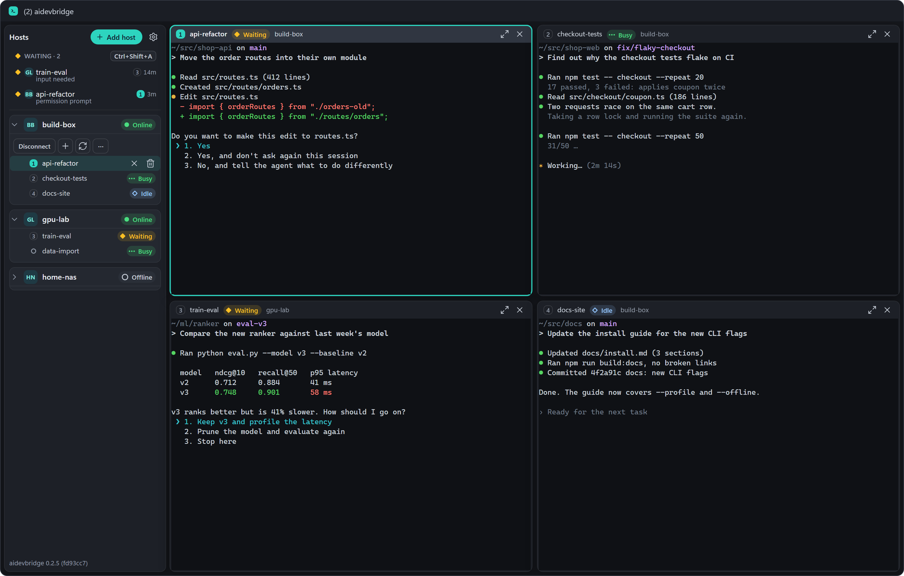
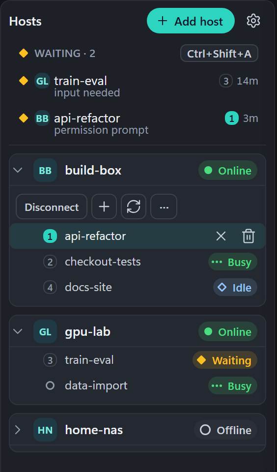
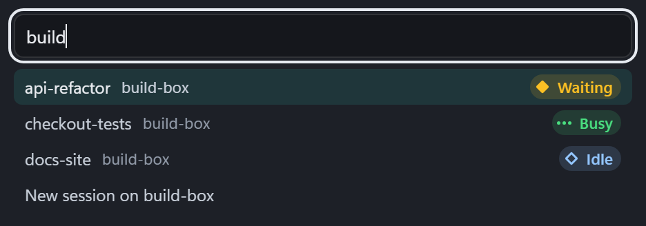
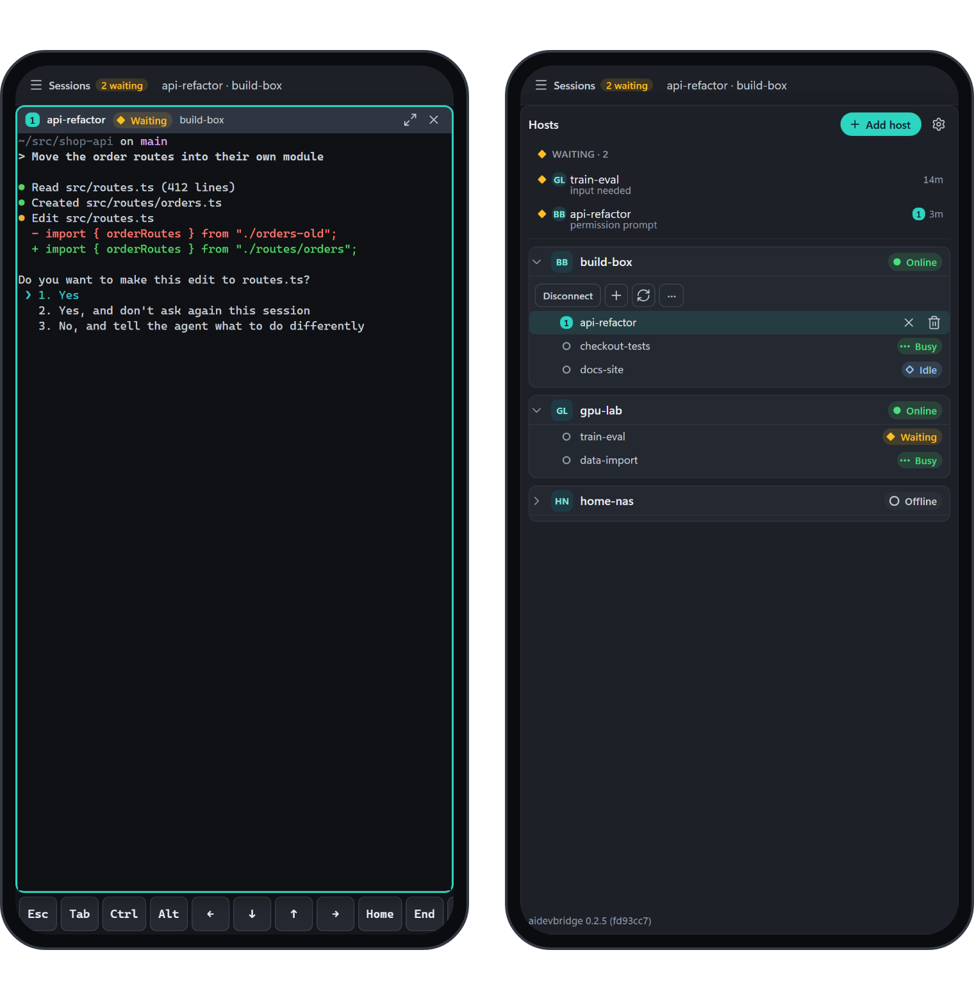
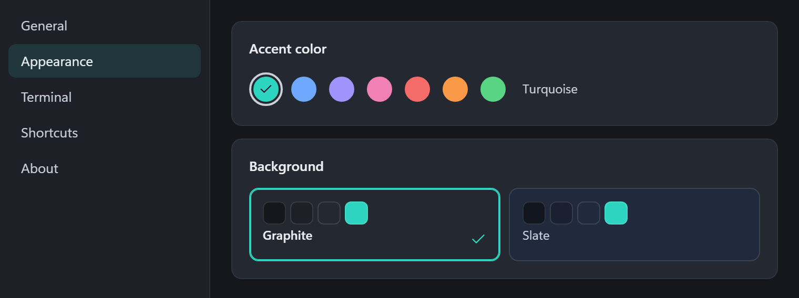
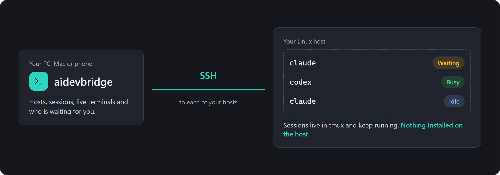

<p align="center">
  
</p>

<h1 align="center">aidevbridge</h1>

<p align="center">
  <strong>See which coding agent is waiting for you.</strong><br>
  All your tmux sessions, on all your Linux hosts, in one app.
</p>

<p align="center">
  <a href="https://github.com/ITBrain258/aidevbridge/releases/latest"></a>
  
  <a href="https://github.com/ITBrain258/aidevbridge/actions/workflows/ci.yml"></a>
  <a href="#license"></a>
</p>

<p align="center">
  <a href="https://github.com/ITBrain258/aidevbridge/releases/latest"><strong>Download</strong></a>
  ·
  <a href="#quick-start">Quick start</a>
  ·
  <a href="docs/guide/agents.md">Supported agents</a>
  ·
  <a href="#documentation">Documentation</a>
</p>



Coding agents stop and ask. When they run in tmux on several machines, you find
out minutes later, after clicking through every terminal. aidevbridge connects to
your hosts over SSH, puts their sessions in one window and shows you who needs an
answer. **Nothing is installed on the hosts.**

- **Waiting, Busy, Idle, Ended.** Every session shows the state of its agent.
- **Your sessions stay yours.** They live in tmux on your hosts and keep running
  when you close the app or lose the network.
- **No account, no cloud, no telemetry.** The app talks to your hosts over SSH and
  to nothing else.

## What it does

<table>
  <tr>
    <td width="44%"></td>
    <td>
      <h3>Never miss a waiting agent</h3>
      Waiting sessions collect at the top of the sidebar, oldest first, with their
      wait time. The window title counts them, the taskbar flashes once when one
      starts waiting while the window is not focused, and
      <kbd>Ctrl</kbd>+<kbd>Shift</kbd>+<kbd>A</kbd> jumps to the next one.
    </td>
  </tr>
  <tr>
    <td>
      <h3>Find anything in a keystroke</h3>
      Quick open (<kbd>Ctrl</kbd>+<kbd>Shift</kbd>+<kbd>P</kbd>) finds sessions,
      hosts and actions, with the status of each session right there. Settings →
      Shortcuts lists every shortcut.
    </td>
    <td width="56%"></td>
  </tr>
  <tr>
    <td></td>
    <td>
      <h3>In your pocket, too</h3>
      The Android app shows one terminal at a time, with the sessions in a drawer, a
      key bar for the keys a phone lacks, and swipe scrolling. It generates its own
      SSH key or imports yours.
    </td>
  </tr>
  <tr>
    <td>
      <h3>Make it yours</h3>
      Seven accent colors on two backgrounds give you 14 themes, and the terminal
      font size is yours to set.
    </td>
    <td></td>
  </tr>
</table>

And the parts you only notice when they are missing:

- **A grid that arranges itself.** Up to nine terminals, at most eight per host.
  Drag a terminal's head onto another to swap them, drag the gap between two to
  resize them, and maximize one with <kbd>Ctrl</kbd>+<kbd>Shift</kbd>+<kbd>M</kbd>.
- **A terminal that behaves like Windows Terminal.** <kbd>Ctrl</kbd>+<kbd>C</kbd>
  copies a selection and otherwise still interrupts the program,
  <kbd>Ctrl</kbd>+<kbd>V</kbd> pastes, <kbd>Ctrl</kbd>+<kbd>Shift</kbd>+<kbd>F</kbd>
  finds text, and <kbd>Ctrl</kbd>+click opens a link in your browser. Opening a
  session loads up to 5,000 lines of its tmux history.
- **It recovers by itself.** Hosts with a key file or ssh-agent repair their
  connection and reattach their terminals after standby, a network change or a VPN
  switch. After a restart the app reconnects them and reopens your terminals.

<sub>The pictures show the real interface with sample data.</sub>

## How it works



No daemon, no hook, no configuration change on the host: only SSH, tmux and the
agent you start yourself. Passwords and key passphrases are never stored.

| Agent | Status | Source |
| --- | --- | --- |
| Claude Code | Yes | `claude agents --json` on the host, read-only |
| Codex | Yes | the terminal title that tmux keeps for the pane |
| Grok | Yes, last measured with an older version | the terminal title that tmux keeps for the pane |
| agy, OpenCode, Gemini CLI and others | Runs fine, status shows "Unknown" | |

A form the app does not know shows "Unknown", never a guess. Details and measured
versions are in [Agents and status](docs/guide/agents.md).

## Download

Get the [latest release](https://github.com/ITBrain258/aidevbridge/releases/latest):

| Platform | File | Needs |
| --- | --- | --- |
| **Windows** | `…-windows-x64-setup.exe`, `.msi` or `.zip` | Windows 10 or 11, x64 |
| **macOS** | `…-macos-universal.dmg` | macOS 11 or newer, Apple silicon or Intel |
| **Android** | `…-android.apk` | Android 7.0 or newer |

> [!NOTE]
> aidevbridge is in early development, and the packages are **not code-signed yet**.
> Windows SmartScreen warns, Smart App Control blocks the app, and macOS refuses the
> first start until you allow it. Every release lists the SHA-256 of each file and
> carries a build provenance you can check. The
> [install guide](docs/guide/install.md) explains each step.

## Quick start

**On each host** you need SSH access, a POSIX login shell and `tmux` 3.0 or newer
([details](docs/guide/hosts.md)):

```sh
sudo apt install tmux      # Debian, Ubuntu
```

**In the app:**

1. Start aidevbridge. The welcome page suggests the hosts from your
   `~/.ssh/config`. Pick one, or add a host by hand with a key file, ssh-agent or a
   password.
2. Compare the host key's fingerprint with the host and choose **Trust and
   continue**. The app then checks the host's requirements and names what is missing.
3. Choose **New session** under the host and pick a working directory.
4. Start your agent in that terminal, for example `claude` or `codex`. Its status
   appears next to the session.

Sessions you started with plain `tmux` show up as well, under **tmux sessions**.

## Documentation

| Guide | What is in it |
| --- | --- |
| [Install](docs/guide/install.md) | Every package, SmartScreen and macOS prompts, checking a download, removing the app |
| [Hosts and tmux](docs/guide/hosts.md) | Host requirements, tmux versions, sessions on tmux's default socket |
| [Agents and status](docs/guide/agents.md) | The states, how each agent is detected, measured versions |
| [Privacy and stored data](docs/guide/data.md) | What the app does on your hosts and keeps on your device |
| [Limits and known gaps](docs/guide/limits.md) | What is not built yet and what to expect |
| [Build and test](docs/guide/building.md) | Building from source, tests, release packages |

What changed is in the [CHANGELOG](CHANGELOG.md), where the project stands in
[docs/stand.md](docs/stand.md) (both in German).

## Contributing

Bug reports and ideas are welcome as
[issues](https://github.com/ITBrain258/aidevbridge/issues/new/choose); please use
the templates. aidevbridge has a single maintainer, so answers can take a while.
Read [CONTRIBUTING.md](CONTRIBUTING.md) before a pull request.

aidevbridge is built with [Tauri 2](https://tauri.app/): a Rust backend and a
TypeScript frontend with xterm.js.

Please report vulnerabilities privately as described in
[SECURITY.md](SECURITY.md), not in a public issue.

## License

aidevbridge is licensed under either of

- Apache License, Version 2.0 ([LICENSE-APACHE](LICENSE-APACHE) or
  <https://www.apache.org/licenses/LICENSE-2.0>)
- MIT license ([LICENSE-MIT](LICENSE-MIT) or
  <https://opensource.org/licenses/MIT>)

at your option.

Third-party material keeps its own license: the bundled components listed
in [THIRD_PARTY_LICENSES.md](THIRD_PARTY_LICENSES.md), the patched `russh` in
`vendor/russh/` (Apache-2.0, see
[AGENTBRIDGE-PATCH.md](vendor/russh/AGENTBRIDGE-PATCH.md)), the upstream test
keys in `src-tauri/tests/fixtures/rsa-signing/` (see
[SOURCES.md](src-tauri/tests/fixtures/rsa-signing/SOURCES.md)) and the
license texts and installer sources under `docs/release/licenses/` and
`docs/release/sources/`. The packages carry the notices selected for their
platform.

Unless you explicitly state otherwise, any contribution intentionally
submitted for inclusion in this work by you, as defined in the Apache-2.0
license, shall be dual licensed as above, without any additional terms or
conditions.
